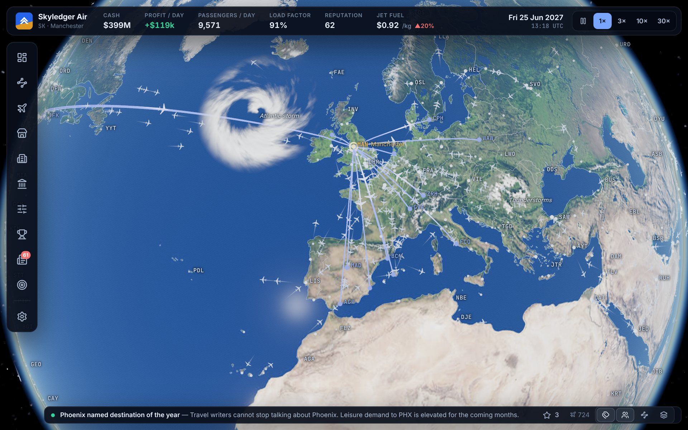
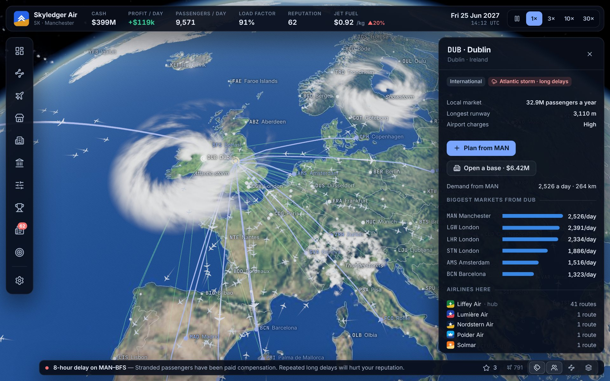
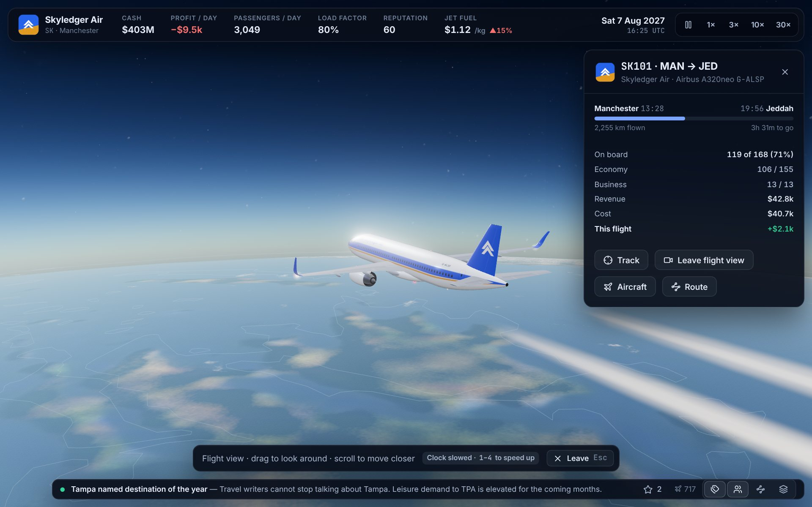
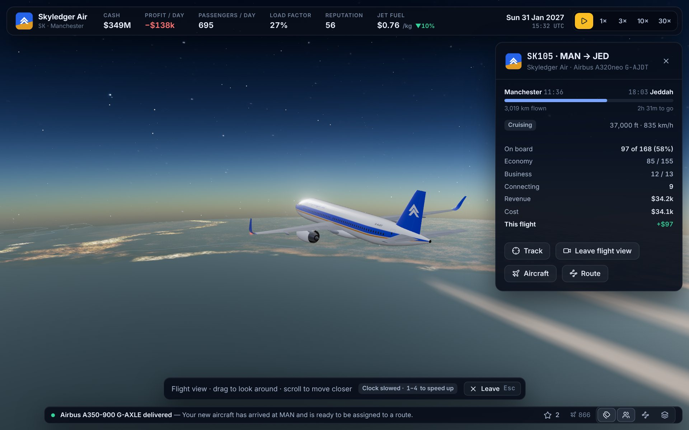
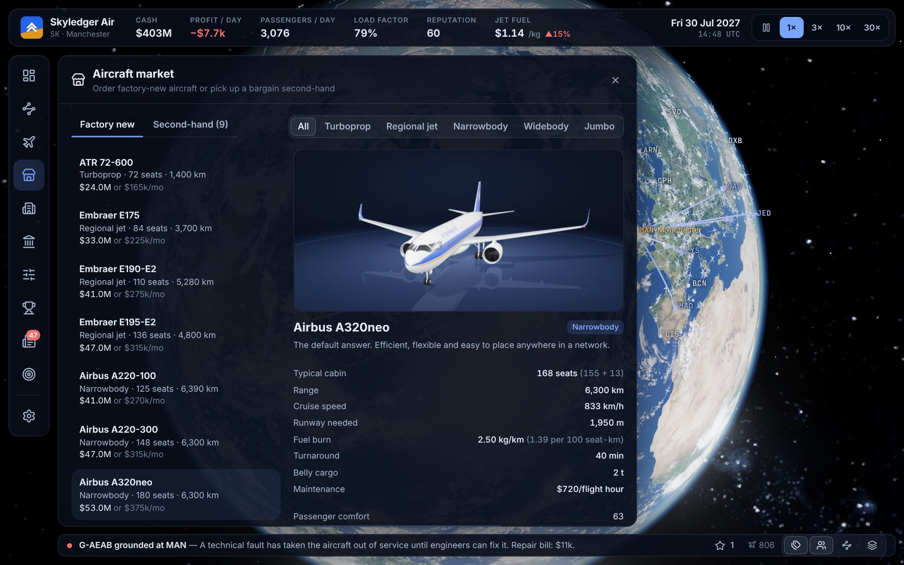

# Skyledger

A 3D airline simulation and business management game that runs in the browser.

Found an airline, lease your first aircraft, and grow it into a global network on a
living, photoreal Earth: 667 real airports, 28 real aircraft types, 39 rival
airlines that plan against you, and an economy in which every seat on every flight
is sold (or not) by a model of who wants to fly where, when, and at what price.



| | |
|---|---|
|  |  |
|  |  |
|  |  |



## Play

```bash
npm install
npm run dev        # then open http://localhost:5173
```

For an optimised build: `npm run build`, then `npm run preview` (or serve `dist/`
from any static host: the build uses relative paths).

You need Node 20.19+ (or 22.12+) and a browser with WebGL 2. Everything runs
locally: there is no server, no account and no network access once the page has
loaded. Saves live in the browser (IndexedDB) and can be exported to a file.

## What is in it

**A living 3D Earth.** Day and night follow the real sun for the game date; city
lights come on across the terminator; the atmosphere is ray-marched (Rayleigh and
Mie scattering), so the limb glows and sunsets redden. The map itself is kept
clear, so that what you see on it is what matters: your network, everyone's
traffic, and the weather that is actually getting in the way. Zoom from deep
space to regional scale and the view tilts towards the horizon. Every aircraft in
the world is drawn in flight, with contrails, along great-circle paths.

**Weather that comes and goes.** Atlantic lows, blizzards, thunderstorms, fog,
sandstorms and named tropical cyclones form where and when they belong, track
across the map, build and fade. An airport under one has delays; under the core
of a severe one it closes, and flights are held on the ground until it has
passed. The airport card shows what is overhead and what is forecast, and
serious weather heading for your airports makes the news a day or two ahead.
Any one place is clear about nine days in ten, even in its stormy season.

**Flight view.** Click any aircraft, yours or a rival's, and ride alongside it:
a full 3D model in its airline's livery, lit by the real sun, over the terrain it
is actually crossing. The clock slows while you watch.

**Real geography.** 667 airports in 194 countries, with real coordinates,
elevations and runway lengths (hot-and-high airports and short runways limit what
can operate there) and curfews for short-haul flying at night. Seventeen of the
world's most congested airports are slot-limited: you can only fly as many
departures as you hold slots for, supply there is short and fares are firm, so
the way to carry more is a bigger aircraft per slot.

**People fly where people really go.** Demand between two airports starts from
how much travel there is between their two countries: some 2,800 country pairs
fitted to approximate real volumes, which is where holidays, family ties, migrant
workers, old empires and business come in. It is then shared among the airports
by what kind of places they are: intercontinental gateways and regional
airports, resorts and business centres, how far apart, and whether a train or a
motorway does the job better. From Manchester that means Dublin, the
Mediterranean and Amsterdam, not Jeddah. Each airport's traffic adds up to its
real-world scale. Demand moves with the season, the economy and events, and
bookings swing from one departure to the next. Three cabin classes respond
differently to price and quality. Travellers you cannot seat go to other
airlines; travellers connect through your hubs.

**28 aircraft types.** From the ATR 72 to the A380, each with range, payload,
fuel burn, runway needs, maintenance and crew costs, daily flying hours they can
realistically keep up, and configurable cabins. Buy or lease, new or second-hand. Every type is modelled procedurally in 3D
(fuselage, wings, engines, landing gear, windows, lights) and painted in your
livery: seven livery styles, ten tail emblems, any colours.

**39 rival airlines.** Legacy carriers, low-cost carriers, regional and premium
airlines, each with a home market and a temperament. They open and close routes,
reprice within days when the market moves, order aircraft and go bust. On long
routes you also compete with changing planes at somebody else's hub. Aircraft
are judged by how well they suit the sector (nobody enjoys four hours in a
turboprop), and their ranges allow for reserves and headwinds. The planner and
every route panel show who carries the market, and how many passengers each
airline gets.

**The business.** Fares by class, set by hand or left to revenue management
that moves each cabin's fare to where it earns the most; promotions, service and
maintenance levels, wages and morale, marketing and reputation, hub development
and transfer traffic, airport slots, fuel hedging, loans and credit ratings,
aircraft leases, cargo and ancillary revenue, punctuality and compensation, a
full income statement and balance sheet.

**Forecasts you can hold to account.** The route planner uses the same market
model the game runs on, at the fares the route will actually charge. It shows
what to expect once the route is established, in its first month, and if a
rival moves in; each route remembers what it was planned for.

**A world that pushes back.** Fuel price swings, recessions and booms, strikes,
volcanic ash, tourism fashions, big events; decisions to take (union
demands, safety audits, manufacturer offers, investors) and 29 milestones to
chase.

**Sound** is synthesised on the fly (no audio files): interface cues, an ambient
pad over the globe, engines and slipstream in the flight view.

## How to play

1. **Found your airline.** Pick a name, a livery and a home base. A big city
   means big markets and entrenched competitors; a smaller one is quieter and
   cheaper.
2. **Get an aircraft** in the aircraft market (`M`). Leasing costs little up
   front; buying is cheaper over the years. A narrowbody suits busy routes of up
   to five or six hours; a turboprop or regional jet suits thin, short ones.
3. **Open a route** from Routes (`N`) → *Plan on the globe*. The planner shows
   the aircraft's range, how much demand each destination has, who already
   carries it, and a forecast of load factor and profit: once established, in
   the first month, and if a rival moves in. The biggest market is not always
   the best bet: a crowded trunk route can pay less than a thinner one nobody
   flies.
4. **Start the clock** (`Space`) and watch the first flights go out.
5. **Leave the fares alone, or don't.** New routes have managed fares: every few
   days each cabin's fare moves to where it earns the most. Your job is the
   bigger picture: the right aircraft on the right route, and enough of them. A
   route that stays cheap and still flies half empty has too many seats on it.
   Switch any route to manual in its panel if you want the wheel.
6. **Build a hub.** When many routes meet at one airport, passengers connect
   between them and fill seats that local demand alone would not. That feed, and
   a good reputation, are what make long-haul widebodies pay: start small.
7. **Mind the slots.** At slot-limited airports, each departure a day needs a
   slot. You get a few with your home base and with each base you build; buy the
   rest on the airport's card, at a price that rises with every one. When slots
   are what holds you back, fly bigger aircraft.
8. **Mind the cash.** Winters are lean, fuel is volatile and rivals react. Hedge
   fuel when it is cheap, and keep a reserve.
9. **Watch the weather.** A storm over one of your airports means delays; a
   typhoon or a blizzard can shut it for a day or two. Click an airport to see
   what is overhead and what is forecast.

| Key | Action |
|---|---|
| `Space` | Pause or resume |
| `1` – `4` | Game speed |
| `O` `N` `F` `M` `B` | Overview, routes, fleet, aircraft market, bases |
| `$` `P` `R` `E` `G` | Finance, product and operations, rivals, news, milestones |
| `Esc` | Close the current panel, cancel planning, leave the flight view |
| Drag, scroll or pinch | Spin and zoom the globe |
| `?` | Help |

Three difficulty levels change starting capital (from $300M down to $80M),
demand, costs, interest rates and how aggressive the rivals are.

## How it works

```
src/
  sim/        The simulation. No DOM, no rendering: runs in Node for the tests.
    data/       Airports and country ties (generated), aircraft types, rival airline templates
    demand.ts   Who wants to fly where: country ties, airport structure, class split, fares, seasons
    pricing.ts  Revenue management: fares that move to where each cabin earns most
    slots.ts    Departure slots at congested airports
    market.ts   Market share between airlines and one-stop itineraries, booking pools, connections
    ops.ts      The flight state machine: turnarounds, legs, delays, costs
    finance.ts  Ledgers, loans, leases, credit, valuation
    ai.ts       Rival airlines
    weather.ts  Weather systems: where they form, how they move, what they do to airports
    world.ts    Fuel, the economy, events, the second-hand market
    planner.ts  Route forecasts and suggestions (shared by the UI and the AI)
    sim.ts      The clock, daily and monthly cycles, save and load
  render/     three.js
    earth.ts    Surface, cloud and atmosphere shaders
    weather.ts  Weather systems drawn on the globe
    sky.ts      Stars, Milky Way, sun
    layers.ts   Borders, airports, route arcs, live traffic
    chase.ts    The flight view
    aircraft/   Procedural aircraft models, liveries, the turntable viewer
  ui/         React: HUD, panels, planner, charts, saves
  audio/      Synthesised sound
scripts/      Data and asset pipelines
tests/        Simulation, demand calibration and balance tests
```

The simulation is deterministic and fully serialisable: the whole game state,
including the random number generator, is plain JSON, and a loaded game plays
out exactly as the original would have. Time advances in one-minute ticks;
aircraft are event-driven, so a tick costs almost nothing unless something
happens in it. The interface never owns game state: it reads the simulation and
calls actions on it.

The flight view solves a scale problem: the planet is 12,700 km across and an
airliner 40 m long, too wide a range for single-precision coordinates. The
aircraft is drawn in its own metre-scale scene and composited over the planet,
with the two cameras kept in exact agreement.

Rendering quality is adjustable (Low to Ultra), and the renderer lowers its own
resolution when a GPU cannot keep up.

## Development

```bash
npm test                 # simulation, demand and balance tests
npm run typecheck
REPORT=1 npm run balance # how a simple bot player fares, and what each home base offers
CALIBRATE=1 npx vitest run tests/demand.test.ts --disable-console-intercept   # the demand model against real routes
```

The demand test compares the model with about 1,700 real routes
(`tests/routes.reference.ts`): the median error is a factor of about 1.5, 70% are
within a factor of two and 86% within three. The model is weakest on
resort-by-resort national tastes (which nationality goes to which island) and in
countries with few airports in the game, where the trunk routes come out too
big.

Useful addresses in development:

- `/?debug=1` exposes the game on `window.__app` for scripted play-throughs.
- `/?dev=globe&lat=48&lon=10&alt=1.2&sim=LHR&days=20` renders the globe alone.
- `/?dev=aircraft&type=b789&style=wave&emblem=bird` shows one aircraft model.

### Rebuilding the data

```bash
npm run data:airports    # airports from OurAirports + scripts/*-curated.txt
npm run data:ties        # country-to-country travel, fitted to scripts/corridors-curated.txt
npm run data:borders     # coastlines and borders from Natural Earth
scripts/process-textures.sh <src-dir> [<8k-dir>]   # Earth textures (needs ImageMagick)
```

The generated files are committed, so none of this is needed to run the game.
`scripts/airports-curated.txt` decides which airports exist and carries the
balance inputs (annual passengers, transfer share, domestic share, and flags
for gateways, resorts and business centres); `scripts/countries-curated.txt`
holds region, wealth, trade bloc, languages, railways and domestic share;
`scripts/corridors-curated.txt` holds passengers a year between pairs of
countries. All of these figures are approximate game-balance inputs, written
down from memory of public statistics of about 2019. They are not statistics,
and should not be used as such.

## Credits and licences

- Earth and Milky Way textures: [Solar System Scope](https://www.solarsystemscope.com/textures/),
  CC BY 4.0, based on NASA imagery.
- Airport data: [OurAirports](https://ourairports.com/data/), public domain.
- Coastlines and borders: [Natural Earth](https://www.naturalearthdata.com/) via
  `world-atlas`, public domain.
- [three.js](https://threejs.org/), [React](https://react.dev/) and
  [Vite](https://vite.dev/) (MIT); [Lucide](https://lucide.dev/) icons (ISC);
  Inter and JetBrains Mono typefaces (SIL Open Font License 1.1).

Aircraft type names belong to their manufacturers and are used here only to
describe the aircraft. Every airline in the game is fictional.
