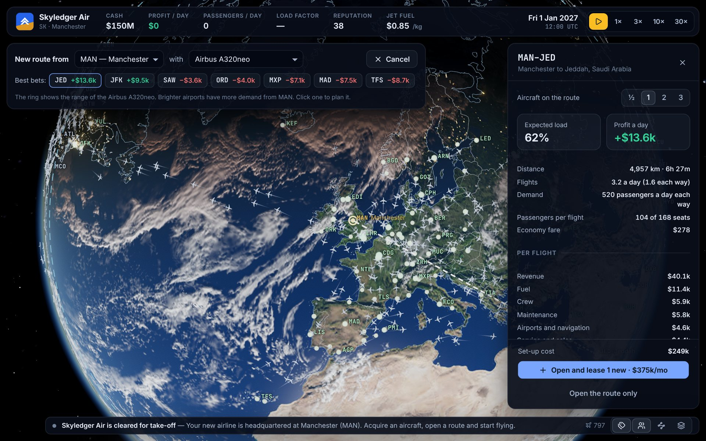
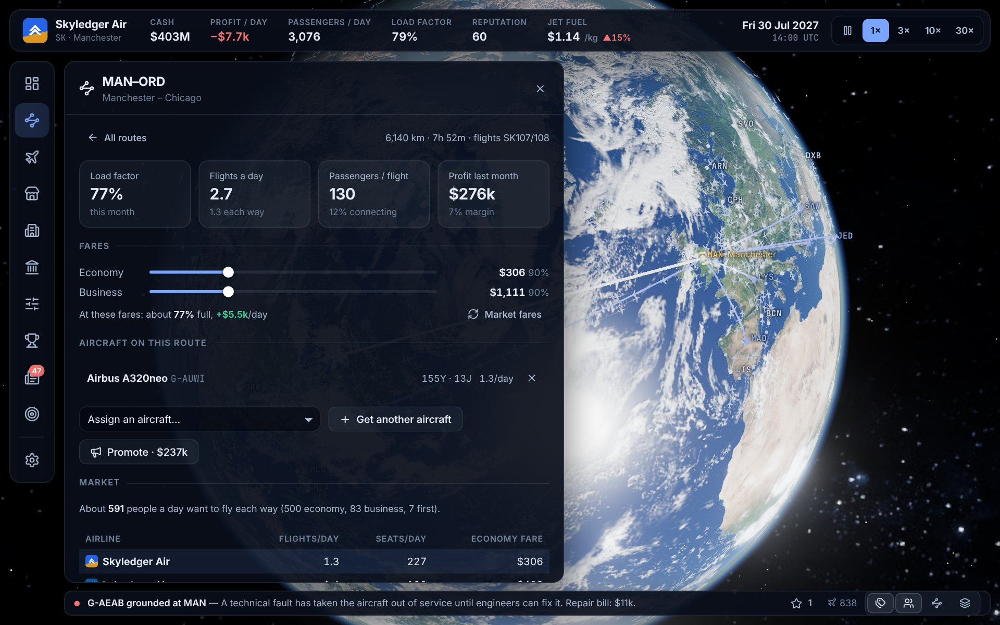
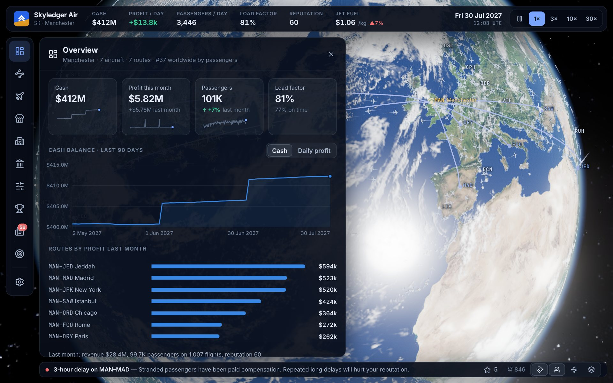

# Skyledger

A 3D airline simulation and business management game that runs in the browser.

Found an airline, lease your first aircraft, and grow it into a global network on a
living, photoreal Earth: 667 real airports, 28 real aircraft types, 39 rival
airlines that plan against you, and an economy in which every seat on every flight
is sold (or not) by a model of who wants to fly where, when, and at what price.


| | |
|---|---|
|  |  |
|  |  |
|  |  |

## Play

```bash
npm install
npm run dev        # then open http://localhost:5173
```

For an optimised build: `npm run build`, then `npm run preview` (or serve `dist/`
from any static host: the build uses relative paths).

You need Node 20.19+ (or 22.12+) and a browser with WebGL 2. Everything runs
locally: there is no server, no account and no network access once the page has
loaded. Saves live in the browser (IndexedDB) and can be exported to a file.

## What is in it

**A living 3D Earth.** Day and night follow the real sun for the game date; city
lights come on across the terminator; clouds drift and cast shadows; the
atmosphere is ray-marched (Rayleigh and Mie scattering), so the limb glows and
sunsets redden. Zoom from deep space to regional scale and the view tilts
towards the horizon. Every aircraft in the world is drawn in flight, with
contrails, along great-circle paths.

**Flight view.** Click any aircraft, yours or a rival's, and ride alongside it:
a full 3D model in its airline's livery, lit by the real sun, over the terrain it
is actually crossing. The clock slows while you watch.

**Real geography.** 667 airports in 194 countries, with real coordinates,
elevations and runway lengths (hot-and-high airports and short runways limit what
can operate there), slot-constrained hubs, and curfews for short-haul flying at
night.

**A demand model, not a lookup table.** Passenger demand between any two cities
comes from a gravity model (city size, wealth, distance, tourism, business ties,
domestic and regional affinities) balanced so that each airport's traffic adds up
to its real-world scale. Demand moves with the season, the day of the week, the
economy and events. Three cabin classes respond differently to price and
quality. Travellers you cannot seat spill to other airlines; travellers connect
through your hubs.

**28 aircraft types.** From the ATR 72 to the A380, each with range, payload,
fuel burn, runway needs, maintenance and crew costs, and configurable cabins.
Buy or lease, new or second-hand. Every type is modelled procedurally in 3D
(fuselage, wings, engines, landing gear, windows, lights) and painted in your
livery: seven livery styles, ten tail emblems, any colours.

**39 rival airlines.** Legacy carriers, low-cost carriers, regional and premium
airlines, each with a home market and a temperament. They open and close routes,
match fares, order aircraft and go bust.

**The business.** Fares by class, promotions, service and maintenance levels,
wages and morale, marketing and reputation, hub development and transfer traffic,
fuel hedging, loans and credit ratings, aircraft leases, cargo and ancillary
revenue, punctuality and compensation, a full income statement and balance
sheet.

**A world that pushes back.** Fuel price swings, recessions and booms, strikes,
storms, volcanic ash, tourism fashions, big events; decisions to take (union
demands, safety audits, manufacturer offers, investors) and 29 milestones to
chase.

**Sound** is synthesised on the fly (no audio files): interface cues, an ambient
pad over the globe, engines and slipstream in the flight view.

## How to play

1. **Found your airline.** Pick a name, a livery and a home base. A big city
   means big markets and entrenched competitors; a smaller one is quieter and
   cheaper.
2. **Get an aircraft** in the aircraft market (`M`). Leasing costs little up
   front; buying is cheaper over the years. A narrowbody suits busy routes of up
   to five or six hours; a turboprop or regional jet suits thin, short ones.
3. **Open a route** from Routes (`N`) → *Plan on the globe*. The planner shows
   the aircraft's range, how much demand each destination has, and a forecast of
   load factor and profit from the same model the game runs on.
4. **Start the clock** (`Space`) and watch the first flights go out.
5. **Tune.** Aim for load factors around 80%. Fuller than that: raise fares or
   add capacity. Emptier: cut fares, fly a smaller aircraft, or let one aircraft
   share several thin routes.
6. **Build a hub.** When many routes meet at one airport, passengers connect
   between them and fill seats that local demand alone would not. That feed, and
   a good reputation, are what make long-haul widebodies pay: start small.
7. **Mind the cash.** Winters are lean, fuel is volatile and rivals react. Hedge
   fuel when it is cheap, and keep a reserve.

| Key | Action |
|---|---|
| `Space` | Pause or resume |
| `1` – `4` | Game speed |
| `O` `N` `F` `M` `B` | Overview, routes, fleet, aircraft market, bases |
| `$` `P` `R` `E` `G` | Finance, product and operations, rivals, news, milestones |
| `Esc` | Close the current panel, cancel planning, leave the flight view |
| Drag, scroll or pinch | Spin and zoom the globe |
| `?` | Help |

Three difficulty levels change starting capital (from $300M down to $80M),
demand, costs, interest rates and how aggressive the rivals are.

## How it works

```
src/
  sim/        The simulation. No DOM, no rendering: runs in Node for the tests.
    data/       Airports (generated), aircraft types, rival airline templates
    demand.ts   Gravity demand model, class split, reference fares, seasons
    market.ts   Market share between airlines, booking pools, connections
    ops.ts      The flight state machine: turnarounds, legs, delays, costs
    finance.ts  Ledgers, loans, leases, credit, valuation
    ai.ts       Rival airlines
    world.ts    Fuel, the economy, events, the second-hand market
    planner.ts  Route forecasts and suggestions (shared by the UI and the AI)
    sim.ts      The clock, daily and monthly cycles, save and load
  render/     three.js
    earth.ts    Surface, cloud and atmosphere shaders
    sky.ts      Stars, Milky Way, sun
    layers.ts   Borders, airports, route arcs, live traffic
    chase.ts    The flight view
    aircraft/   Procedural aircraft models, liveries, the turntable viewer
  ui/         React: HUD, panels, planner, charts, saves
  audio/      Synthesised sound
scripts/      Data and asset pipelines
tests/        Simulation, demand calibration and balance tests
```

The simulation is deterministic and fully serialisable: the whole game state,
including the random number generator, is plain JSON, and a loaded game plays
out exactly as the original would have. Time advances in one-minute ticks;
aircraft are event-driven, so a tick costs almost nothing unless something
happens in it. The interface never owns game state: it reads the simulation and
calls actions on it.

The flight view solves a scale problem: the planet is 12,700 km across and an
airliner 40 m long, too wide a range for single-precision coordinates. The
aircraft is drawn in its own metre-scale scene and composited over the planet,
with the two cameras kept in exact agreement.

Rendering quality is adjustable (Low to Ultra), and the renderer lowers its own
resolution when a GPU cannot keep up.

## Development

```bash
npm test                 # simulation, demand and balance tests
npm run typecheck
REPORT=1 npm run balance # how a simple bot player fares, and what each home base offers
```

Useful addresses in development:

- `/?debug=1` exposes the game on `window.__app` for scripted play-throughs.
- `/?dev=globe&lat=48&lon=10&alt=1.2&sim=LHR&days=20` renders the globe alone.
- `/?dev=aircraft&type=b789&style=wave&emblem=bird` shows one aircraft model.

### Rebuilding the data

```bash
npm run data:airports    # airports from OurAirports + scripts/*-curated.txt
npm run data:borders     # coastlines and borders from Natural Earth
scripts/process-textures.sh <src-dir> [<8k-dir>]   # Earth textures (needs ImageMagick)
```

The generated files are committed, so none of this is needed to run the game.
`scripts/airports-curated.txt` decides which airports exist and carries the
balance inputs (annual passengers, transfer share, character flags);
`scripts/countries-curated.txt` holds region, wealth and trade bloc.

## Credits and licences

- Earth and Milky Way textures: [Solar System Scope](https://www.solarsystemscope.com/textures/),
  CC BY 4.0, based on NASA imagery.
- Airport data: [OurAirports](https://ourairports.com/data/), public domain.
- Coastlines and borders: [Natural Earth](https://www.naturalearthdata.com/) via
  `world-atlas`, public domain.
- [three.js](https://threejs.org/), [React](https://react.dev/) and
  [Vite](https://vite.dev/) (MIT); [Lucide](https://lucide.dev/) icons (ISC);
  Inter and JetBrains Mono typefaces (SIL Open Font License 1.1).

Aircraft type names belong to their manufacturers and are used here only to
describe the aircraft. Every airline in the game is fictional.
